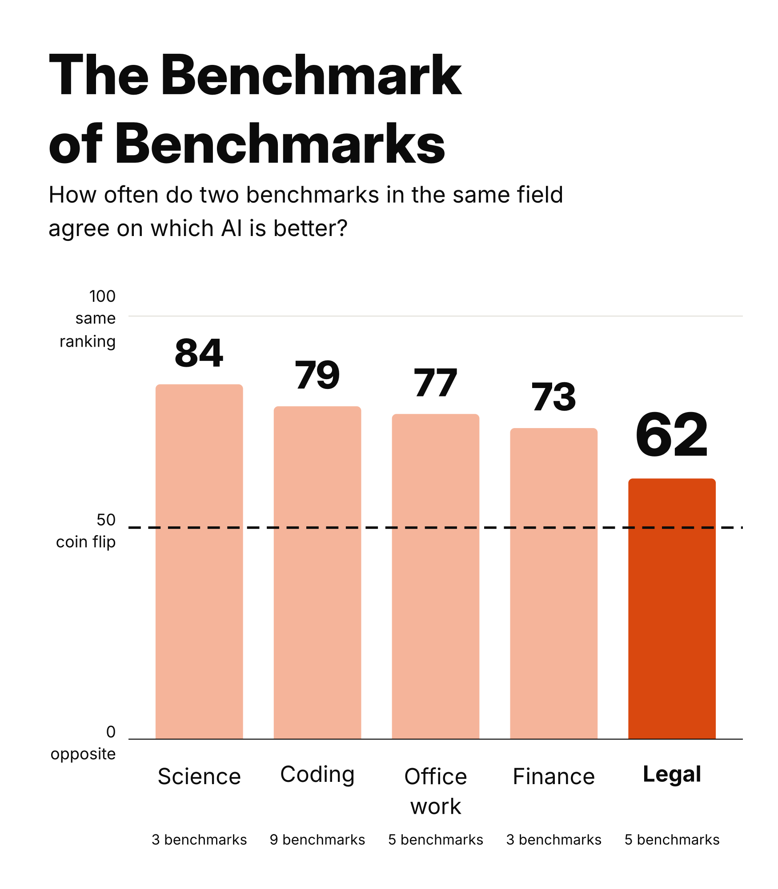
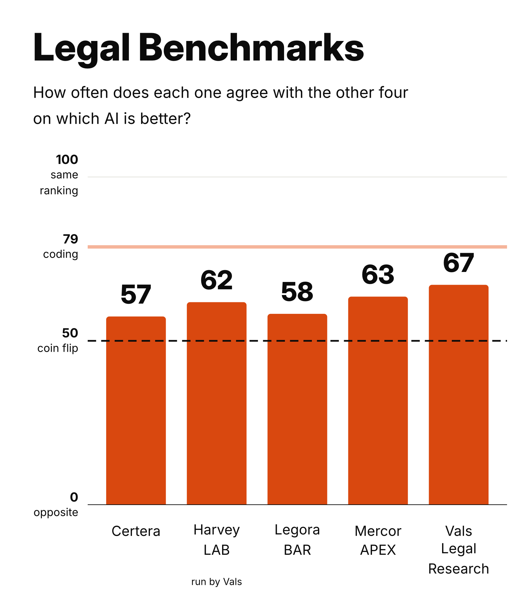

# The Benchmark of Benchmarks: everything

Compiled 14 November 2026 from the analysis files. Leaderboard data was collected 9 to 11 November 2026. The 37 models are the ones Vals ran on Harvey LAB between 19 October and 9 November 2026.

## The two final charts





## The final captions

Post 1:

```
i benchmarked the benchmarks

if you ask which AI model is better, different coding benchmarks agree 79% of the time vs 62% for legal (coin flip = 50%)

each benchmark has its own standard for good answers but those vary more in law than other fields
```

Post 2:

```
how much should you trust a legal benchmark? way less than a coding one

- a few points up/down is largely arbitrary
- if many benchmarks agree, the model is probably just stronger overall (not necessarily better at law)
```

## Headline numbers

| Field | Agreement on which of two models is better | Benchmarks |
|---|---|---|
| Science | 83.8% (72 to 92) | 3 |
| Coding | 78.6% (71 to 84) | 9 |
| Office work | 76.8% (70 to 82) | 5 |
| Finance | 73.5% (64 to 81) | 3 |
| Legal (five on the chart) | 61.6% (53 to 72) | 5 |
| Legal (nine by the rule) | 63.0% (57 to 70) | 9 |

A coin flip is 50%. Ranges are 95% intervals from resampling the models.

---

# Part 1. The full write-up


Draft, 11 November 2026. On a draft branch, not on the site.

## The finding

Pick any two current AI models. Two legal benchmarks agree on which one is better 62% of the time. Two coding benchmarks agree 79% of the time, on the same pool of models. Guessing would give 50%.

| Comparison | Agreement on which of two models is better | 95% interval |
|---|---|---|
| The same benchmark, run by two evaluators | 85% to 94% | range across four reruns |
| Two different coding benchmarks (8 benchmarks, 28 pairings) | 79% | 71% to 85% |
| Two different legal benchmarks (5 benchmarks, 10 pairings) | 62% | 53% to 72% |

The gap between coding and legal is 17 points, with a 95% interval of 7 to 26. Coding came out at or below legal in 0.2% of resamples.

The same result as a rank correlation (Spearman, where 0 is an unrelated order and 1 is identical): legal benchmarks typically agree at 0.32 (interval 0.06 to 0.57), coding benchmarks at 0.74 (0.56 to 0.84). The gap is 0.41, with an interval of 0.15 to 0.66.

Legal benchmarks do agree more often than chance. They agree less than coding benchmarks do, and much less than one benchmark agrees with a rerun of itself. Harvey's LAB has been run by three evaluators (Vals, Artificial Analysis, Mercor), and those runs agree 85% to 92% of the time. Terminal-Bench 4, run by Vals and Artificial Analysis, agrees 94% of the time.

## The five legal benchmarks

| Benchmark | Publisher | Run by | Answers judged by | Models of the 37 | Top model | Agreement with the other four | 95% interval |
|---|---|---|---|---|---|---|---|
| Legal Research Bench | Vals | Vals | AI judge, written rubric, citations checked | 37 | Gemini 4 Carbon | 67% | 57% to 77% |
| APEX-Agents, corporate law | Mercor | Mercor | AI judge, expert-written rubric | 30 | GPT-6 Astra | 63% | 53% to 74% |
| LAB | Harvey | Vals | AI judge, written rubric | 37 | Gemini 4 Argon | 62% | 51% to 73% |
| BAR | Legora | Legora | AI judge, criteria written by legal professionals | 15 | Claude Opus 5.5 | 58% | 42% to 72% |
| Legal AI Leaderboard | Certera | Certera | blind head-to-head votes by legal professionals | 24 | GPT-6.1 Sol | 57% | 47% to 71% |

The intervals overlap almost completely, so the order of the five says little. The score measures agreement with the other four, not quality: a low score means a benchmark ranks models differently, not that it is wrong.

On the public pages each of the five has a different model in first place, but that is not a like-for-like comparison. Vals Legal Research's leader, Gemini 4 Carbon, is not on Legora's or Certera's leaderboard, and neither are the two models released on 9 November (Claude Fable 5.2 and Muse Ember). Among the 13 models that are on all five (leaving out names that could not be matched with certainty), there are 4 different leaders: Harvey LAB and Vals Legal Research both put Gemini 4 Argon first. On the same basis the eight coding benchmarks (without the second Vibe Code Bench leaderboard) also have 4 different leaders among 11 models, so the number of different leaders does not separate the fields. In coding one model leads 5 of the eight; in legal no model leads more than 2 of the five.

Rank among the 13 models on all five, for every model in the top three on any of them:

| Model | Harvey LAB | Vals Legal Research | Mercor APEX law | Legora BAR | Certera |
|---|---|---|---|---|---|
| Muse Wonder | 2 | 2 | 3 | 2 | 7 |
| Gemini 4 Argon | 1 | 1 | 2 | 9 | 4 |
| Claude Opus 5.5 | 10 | 2 | 4 | 1 | 6 |
| Gemini 3.8 Flash | 6 | 11 | 8 | 3 | 2 |
| GPT-6.1 Sol | 12 | 12 | 5 | 4 | 1 |
| GPT-6 Astra | 11 | 10 | 1 | 10 | 3 |
| Grok 4.7 | 3 | 6 | 13 | 4 | 13 |

The four leaders were released between 2026-09-03 and 2026-09-30 (dates from Mercor's page data), before Legora's October release and Certera's 9 November update, so their low ranks elsewhere are not a matter of timing. Ties share a rank. Certera publishes a rank range for each model: Gemini 4 Argon's is 2 to 21 of 80 and GPT-6.1 Sol's is 1 to 4.

Four of the five describe their grading the same way: a written rubric scored by an AI judge. The rubrics are mostly private (LAB's are public), so a reader cannot see how the standards differ. Certera is the only one where people judge the answers. The four rubric benchmarks agree with each other 64% of the time and with Certera's votes 57%; the difference is 7 points with an interval of -7 to 22, so it is not clearly different from zero. SemiAnalysis' GDPx legal, in the rule-based set below, also uses an AI judge, against rubrics and reference answers written by lawyers.

Harvey wrote LAB, but its own published results cover only older models. Scores for current models come from other parties running it. Vals' run is used because it covers the most models and reports a margin of error for each score. Vals Legal Research is a separate benchmark with its own tasks.

| Pairing | Shared models | Agree on which of two models is better |
|---|---|---|
| Harvey LAB and Vals Legal Research | 37 | 75% |
| Mercor APEX law and Certera | 23 | 69% |
| Vals Legal Research and Mercor APEX law | 30 | 69% |
| Vals Legal Research and Legora BAR | 15 | 64% |
| Harvey LAB and Legora BAR | 15 | 62% |
| Harvey LAB and Mercor APEX law | 30 | 62% |
| Vals Legal Research and Certera | 24 | 60% |
| Mercor APEX law and Legora BAR | 15 | 54% |
| Legora BAR and Certera | 15 | 52% |
| Harvey LAB and Certera | 24 | 48% |

No single benchmark produces the low figure. Leaving any one of the five out, the other four agree 58% to 64% of the time.

Every pairing is in `data/pairs.csv` and the scores used are in `data/scores.csv`.

## Method

- **Models.** The 37 models Vals ran on Harvey's LAB between 19 October and 9 November 2026. This set is defined by recency, not by score. Each pairing of benchmarks is compared on the models both tested, and needs at least 10 shared models.
- **Scores.** Each benchmark's own headline score, taken from the publisher's site on 11 November 2026. Where a source ran a model at several effort settings, the highest setting is used.
- **Agreement.** For two benchmarks, the share of model pairs they put in the same order, over the models both tested (ties dropped). A group's figure is the average over every pairing in the group. Spearman rank correlation is reported alongside, as the median over pairings.
- **Intervals.** Models were resampled with replacement and every statistic recomputed (2,000 times for the agreement shares, 3,000 for the correlations).
- **Coding reference.** Terminal-Bench 4, Vibe Code, Code Migration, IOI, ProgramBench and SWE-bench Multimodal (all as run by Vals), plus FrontierCode 2 and SciCode (Artificial Analysis).
- **Model names.** Sources label models differently. Names were matched by rule and then checked by hand. Three labels were treated as the same model as a differently named entry elsewhere: Reflection's Beam, Tencent's Hy4 and Nvidia's Nemotron 3.5 Super VL. Four further matches are less certain (Mistral Large 4, DeepSeek V4.1 Flash, Qwen 3.8 Max, Hy4), and the result is also reported without those models.

## Which benchmarks are in, and why

The five legal benchmarks in the charts were chosen by hand: the best-known ones with enough current models. To check that the choice does not drive the result, one written rule was also applied the same way to every field.

**The rule.** A benchmark counts if (1) it has its own published leaderboard with a score per model, (2) at least 15 of the 37 models are on it, (3) it is the latest version, and (4) it is counted once, using the run with the most of the 37 models when several evaluators ran it. Combined indices and breakdowns inside a general benchmark do not count. A field is reported only if at least three benchmarks qualify. Vals' benchmarks are assigned to fields by Vals' own labels.

Every legal candidate found, and what the rule does with it:

| Benchmark | Run by | Models of the 37 | Rule | In the hand-picked five |
|---|---|---|---|---|
| Harvey LAB (Vals run) | Vals | 37 | in | yes |
| Legal Research Bench (Vals) | Vals | 37 | in | yes |
| Mercor APEX, corporate law | Mercor | 30 | in | yes |
| Certera | Certera | 24 | in | yes |
| GDPx legal (SemiAnalysis) | SemiAnalysis | 20 | in | no, left out by choice |
| Immigration (Vals) | Vals | 19 | in | no, left out by choice |
| Legora BAR | Legora | 15 | in | yes |
| Contract Workflows (legalbenchmarks.ai) | legalbenchmarks.ai | 15 | in | no, left out by choice |
| Data Extraction (legalbenchmarks.ai) | legalbenchmarks.ai | 15 | in | no, left out by choice |
| GDP.pdf legal slice (AA) | Artificial Analysis | 34 | out: a breakdown inside a general benchmark, not its own leaderboard | no |
| Omniscience law slice (AA) | Artificial Analysis | 33 | out: a breakdown inside a general benchmark, not its own leaderboard | no |
| Harvey LAB (Mercor run) | Mercor | 27 | out: second run of a benchmark already listed | no |
| Harvey's Legal Agent Benchmark v1 (Vals) | Vals | 25 | out: older version of a benchmark already listed | no |
| Harvey LAB (AA run) | Artificial Analysis | 19 | out: second run of a benchmark already listed | no |
| DAYJOB law (Surge) | Fireworks copy | 14 | out: only 14 of the 37 models | no |
| LegalBench (Vals) | Vals | 13 | out: only 13 of the 37 models | no |
| SnorkelLegal | Snorkel | 11 | out: only 11 of the 37 models | no |
| PRBench legal (Scale) | Scale | 11 | out: only 11 of the 37 models | no |
| CorporateBench (Epiq) | Fireworks | 9 | out: only 9 of the 37 models | no |
| Dutch legal research DELTA | legalbenchmarks.ai | 5 | out: only 5 of the 37 models | no |
| CaseLaw v2 (Vals) | Vals | 1 | out: only 1 of the 37 models | no |

The legal figure under different choices:

| Choice | Benchmarks | Pairings | Agreement | 95% interval |
|---|---|---|---|---|
| The written rule | 9 | 36 | 63% | 57% to 70% |
| The hand-picked five (used in the charts) | 5 | 10 | 62% | 53% to 72% |
| Rule with a minimum of 10 models | 13 | 57 | 63% | 57% to 70% |
| Rule with a minimum of 20 models | 5 | 10 | 65% | 57% to 75% |
| Rule, one benchmark per publisher | 7 | 21 | 62% | 55% to 69% |
| Rule, plus the two Artificial Analysis slices | 11 | 55 | 63% | 57% to 69% |
| Rule, without Certera's votes | 8 | 28 | 64% | 56% to 72% |
| Rule, only benchmarks run by an independent evaluator or by vote | 7 | 21 | 62% | 56% to 69% |
| Only Harvey LAB, Vals Legal Research and Mercor APEX | 3 | 3 | 68% | 58% to 78% |

Every choice with five or more benchmarks gives 62% to 65%. The hand-picked five is at the low end of that range. With only three benchmarks the figure is 68%, the gap to coding shrinks to 10 points, and its interval (0 to 21) reaches zero. Mercor's corporate-law score is one job out of three inside APEX-Agents; it is counted because Mercor publishes it as its own leaderboard.

## Other fields, same pool of models, same rule

| Field | Benchmarks | Pairings | Agreement | 95% interval | Run by |
|---|---|---|---|---|---|
| Science | 3 | 3 | 84% | 72% to 92% | Vals |
| Coding | 9 | 36 | 79% | 71% to 84% | Vals, Artificial Analysis |
| Office work | 5 | 10 | 77% | 70% to 82% | Artificial Analysis, Mercor |
| Finance | 3 | 3 | 73% | 64% to 81% | Vals |
| Legal (written rule) | 9 | 36 | 63% | 57% to 70% | six different parties |
| Legal (hand-picked five) | 5 | 10 | 62% | 53% to 72% | four different parties |

Legal (hand-picked five) against each field separately, resampling the same models for both:

| Field | Points above legal | 95% interval | Resamples where the field is not above legal |
|---|---|---|---|
| Science | 22 | 7 to 34 | 0.3% |
| Coding | 17 | 7 to 26 | 0.1% |
| Office work | 15 | 6 to 23 | 0.1% |
| Finance | 12 | 3 to 20 | 0.8% |

Legal is below each of the four, and each interval excludes zero. These are four comparisons with no correction for making several, and science and finance have three benchmarks each.

Two fields have only two qualifying benchmarks, so one pairing each, and are not reported as fields: medicine (77%, interval 68% to 86%) and cyber (40%, interval 20% to 64%). Cyber's single pairing is lower than legal. An earlier draft showed medicine and merged a maths benchmark into science; both were inconsistent with the rule and have been removed. Maths and general knowledge have one qualifying benchmark each.

Science and finance were each run by a single evaluator, and legal benchmarks by four to six different parties. Where the evaluator differs, coding pairings agree 80% of the time (12 pairings), against 60% for legal (9 pairings). The one legal pairing run by the same evaluator (Harvey LAB and Vals Legal Research, both run by Vals) agrees 75% of the time.

A legal benchmark agrees with a coding benchmark 66% of the time (40 pairings), against 62% with another legal benchmark. The difference is 4 points with an interval of -2 to 10, so it is not clearly different from zero. The next section tests directly whether legal benchmarks share anything beyond general model strength.

## How far does a lead on one benchmark carry?

For each benchmark, pairs of models are split into thirds by the size of the gap between them. The figure is how often another benchmark in the same field puts the same model ahead.

| Field | Closest third of gaps | Middle third | Widest third | Widest tenth |
|---|---|---|---|---|
| Science | 68% (53 to 82) | 87% (69 to 99) | 97% (90 to 100) | 95% |
| Coding | 62% (57 to 69) | 79% (70 to 90) | 95% (89 to 98) | 98% |
| Office work | 60% (55 to 66) | 78% (69 to 86) | 92% (83 to 97) | 98% |
| Finance | 55% (48 to 64) | 74% (61 to 86) | 92% (80 to 98) | 98% |
| Legal (written rule) | 56% (50 to 62) | 61% (55 to 72) | 73% (63 to 81) | 81% |
| Legal (hand-picked five) | 57% (49 to 66) | 59% (50 to 71) | 69% (57 to 81) | 75% |

A small lead is close to a coin flip in every field. The difference is at the other end: in the four other fields a wide lead on one benchmark holds on another 92% to 97% of the time, and in legal about 70%. Leaving any one of the five legal benchmarks out, the widest-third figure is 64% to 76%. The widest third means gaps over 10 points on Harvey LAB, over 12.5 on Vals Legal Research and over 7 on Mercor APEX law; the closest third means gaps under about 5, 6 and 3 points.

## Do legal benchmarks share anything beyond general strength?

A model's general strength is taken as its average standardised score on the benchmarks of the other fields. The table gives the average rank correlation between two benchmarks in a field, and the same after general strength is removed.

| Field | Rank correlation | After removing general strength | 95% interval |
|---|---|---|---|
| Science | 0.82 | 0.56 | 0.11 to 0.85 |
| Coding | 0.72 | 0.29 | 0.16 to 0.47 |
| Office work | 0.71 | 0.22 | 0.06 to 0.39 |
| Finance | 0.64 | 0.14 | -0.05 to 0.34 |
| Legal | 0.29 | 0.08 | -0.07 to 0.27 |

On average the five legal benchmarks share almost nothing beyond general strength, and the interval includes zero. Science, coding and office work keep a shared part of their own. The legal figure barely moves if the fields are weighted equally or coding is left out of general strength.

The average hides one exception. Harvey LAB and Vals Legal Research correlate 0.68 after general strength is removed, and 0.66 when Mercor's run of LAB is used instead of Vals', so this is not an effect of who ran it. For Harvey LAB, Vals Legal Research and Mercor APEX law together the figure is 0.30 (0.04 to 0.56). The two models those three place highest, Gemini 4 Argon and Muse Wonder, are 6th and 10th of 36 on general strength. The data cannot say whether what these benchmarks share is legal skill or a similar way of grading.

## The same models for every field

The comparisons above use the same pool of 37 models, but each pairing only uses the models both benchmarks tested, and legal pairings share fewer models (15 to 37) than coding pairings. To rule that out as the cause, every field was scored on exactly the same 15 models, the ones all five legal benchmarks tested.

| Field | Agreement on those 15 models | 95% interval | Gap to legal | Interval on the gap |
|---|---|---|---|---|
| Science | 83% | 69% to 93% | 26 points | 9 to 40 |
| Coding | 76% | 67% to 84% | 20 points | 6 to 32 |
| Office work | 74% | 64% to 83% | 18 points | 4 to 31 |
| Finance | 73% | 58% to 84% | 16 points | 2 to 28 |
| Legal | 57% | 47% to 67% | | |

The gap is at least as large on identical models. On this strictest comparison the legal interval includes 50%, so legal agreement cannot be clearly told apart from a coin flip there.

## Where the gap comes from

Vals reports a margin of error for every score, so for Vals-run benchmarks the effect of noise can be separated from real disagreement. The ceiling is how often two benchmarks would agree if they ranked models identically underneath and differed only by their reported noise.

| Field (Vals-run benchmarks only) | Ceiling from noise alone | Actual agreement | Shortfall |
|---|---|---|---|
| Science | 90% | 84% | 6 points |
| Coding | 87% | 80% | 7 points |
| Finance | 83% | 73% | 10 points |
| Legal | 83% | 68% | 14 points |

- **Noise caps every field well below 100%.** Current models score close together relative to the margins of error. Legal and finance have the same ceiling, so noise does not explain why legal is lower than finance.
- **With one evaluator, legal is close to finance.** 68% against 73%, on three legal pairings. One of them (Harvey LAB and Vals Immigration, 58%) accounts for most of the difference.
- **The larger drop comes when different parties build and run the benchmarks.** Legal falls from 68% within Vals to 60% across parties. Coding does not fall (78% within one evaluator, 80% across).

The cross-party drop is consistent with each party applying its own standard of good legal work, and also with differences in setup, such as Legora testing inside its own product and Certera collecting votes on chat answers. The data cannot separate the two. Pairings of the three rubric-graded agent benchmarks (Harvey, Vals, Mercor) agree more than pairings involving Certera or Legora.

## Tasks or standard?

Two benchmarks can disagree because they set different tasks or because they judge answers differently. These checks hold one fixed and change the other (figures from `scripts/tasks_vs_standard.py`).

| What changes | Agreement on which of two models is better |
|---|---|
| Nothing: one benchmark split into random halves (LAB, Vals Legal Research) | 87% |
| Area of law: LAB's deal-work practice areas against its disputes and regulatory ones | 90% |
| Who runs it: LAB run by Vals, Artificial Analysis and Mercor | 85% to 92% |
| The scoring rule: LAB scored all-or-nothing against per criterion | 88% |
| Kind of work: Legora's task families (draft, review, extract and so on), 9 models | 73%, against 80% for the same family in two editions |
| One rule about what counts as good: LAB with and without the penalty for made-up facts, 25 models | 79% |
| The whole benchmark: two different legal benchmarks | 62% |

For reference, random halves of Terminal-Bench 4 (coding) agree 90% of the time and of Vals' Finance Agent 81%. Inside one benchmark, legal tasks are as consistent as coding tasks.

On the same LAB answers, ranking models by rubric pass rate and ranking them by fewest made-up facts agree 55% of the time. Area of law and the evaluator make no measurable difference. Kind of work costs a few points on thin data. A change in what counts as a good answer moves rankings the most of the things that could be isolated. Legora's comparison rests on 9 models, and the made-up-facts check is done by a single AI judge.

## Other ways of counting agreement

The headline counts how often two benchmarks agree on which of two models is better. That is Kendall's rank correlation written as a share, (tau + 1) / 2, the usual statistic in benchmark agreement testing. The same comparison under other counts, with coding as the nine benchmarks chosen by the rule:

| Measure | Legal | Coding | By chance |
|---|---|---|---|
| Which of two models is better | 62% (54 to 71) | 79% (71 to 85) | 50% |
| Same order for three models | 29% (20 to 40) | 51% (39 to 62) | 17% |
| Same top model, among the models both tested | 0% (0 to 37) | 28% (20 to 77) | depends on the number of models |
| Overlap of the top three | 27% (23 to 57) | 64% (53 to 83) | depends on the number of models |

Every count puts legal below coding. The top-model counts use one or three models per leaderboard, so a single model added or missing changes them, which is why their intervals are so wide.

The headline uses every pair among the 37 models, including pairs of a strong and a weak model. Restricted to the strongest models (ranked by average percentile over every benchmark in the five fields):

| Models | Legal | Coding |
|---|---|---|
| Strongest 10 | 51% (42 to 88) | 67% (55 to 89) |
| Strongest 15 | 55% (45 to 72) | 72% (62 to 82) |
| Strongest 20 | 55% (46 to 66) | 74% (65 to 81) |

Among the strongest models both figures are lower and legal is close to a coin flip; the gap remains, with wide intervals. Leaving out the four models whose names were matched across publishers with less certainty gives 64% for legal and 81% for coding.

LegalBench is not among the legal benchmarks because the only current leaderboard for it, Vals', has 13 of the 37 models (last updated 13 October 2026), below the minimum of 15. Their scores run from 82 to 88. Adding it anyway gives 64% over 14 pairings.

## Robustness (Spearman rank correlation)

| Check | Legal | Coding | Gap |
|---|---|---|---|
| Main result | 0.32 | 0.74 | 0.41 |
| Coding reference limited to four benchmarks | 0.32 | 0.73 | 0.41 |
| Four models with uncertain name matches removed | 0.35 | 0.76 | 0.41 |
| Kendall's tau instead of Spearman | 0.23 | 0.56 | 0.33 |
| All models any source tested, not just the 37 | 0.33 | 0.77 | 0.44 |
| Only pairings sharing 15 or more models | 0.32 | 0.74 | 0.41 |
| Leaving out any one legal benchmark | 0.21 to 0.41 | 0.74 | 0.32 to 0.53 |

On the agreement-share measure:

| Check | Legal | Coding |
|---|---|---|
| Main result | 62% | 79% |
| Harvey LAB taken from Mercor's run instead of Vals' | 61% | 79% |
| Harvey LAB taken from Artificial Analysis' run, ungated | 61% | 79% |
| Harvey LAB taken from Artificial Analysis' run, hallucination-gated | 62% | 79% |
| Pairings run by the same evaluator | 75% (1 pairing) | 78% (16 pairings) |
| Pairings run by different evaluators | 60% (9 pairings) | 80% (12 pairings) |
| Every field on the same 15 models | 57% | 76% |

## Limits

- **It shows that the rankings differ, not why.** Legal work may be several distinct skills (research, drafting, review), in which case lower agreement is expected and is not a flaw in any benchmark.
- **The benchmarks measure different things.** Certera is blind votes by legal professionals on their own prompts. The others are rubric-graded tasks. Legora runs each model inside its own product, so a score reflects the model plus that setup.
- **Five benchmarks is a small set.** There are ten pairings, and four of them involve Legora, which shares only 15 models with the others and publishes only scores relative to its average, with many ties.
- **Margins of error are mostly unpublished.** Only Vals publishes a standard error per model, so noise could be separated from real disagreement only for Vals-run benchmarks.
- **Effort settings differ between sources.** Vals ran Claude Fable 5.2 at high effort and others ran it at max. The same mismatch applies to the coding reference, where agreement stayed high.
- **The other fields are thin.** Science and finance have three benchmarks each, all run by Vals.
- **Coding benchmarks are not a gold standard.** They are a reference from a field where benchmarks are broadly trusted.
- **It is one month of data.**

## Other observations from the data

- **LAB's scoring rule shrinks scores without reordering models.** On Vals' run, models pass 73% to 96% of individual rubric criteria but only 2% to 27% of whole tasks. The two rankings have a rank correlation of 0.88.
- **LAB's ranking changes when hallucinations are penalised.** Artificial Analysis zeroes any task with a material hallucination. Its ungated and gated rankings have a rank correlation of 0.75, and Gemini 4 Argon falls from 20.8% to 3.9%. Artificial Analysis published this itself in October.
- **The hallucination check depends on the checking model.** In Artificial Analysis' own comparison on 20 tasks, the count of material hallucinations ranged from 1.4 to 23.5 per task depending on which model did the checking. It uses the strictest, GPT-6 Sol.

## Related work

- **Comparing benchmarks by how they rank models is an established method.** Perlitz et al. (2024), *Do These LLM Benchmarks Agree? Fixing Benchmark Evaluation with BenchBench* (arXiv 2407.13696), call it benchmark agreement testing and warn that results depend on which models are compared. The same-models check and the cross-field comparison above are meant to address that.
- **Rubric grading has been tested against expert preference in legal work.** *JudgmentBench* (arXiv 2605.25240) collected rubric scores and pairwise preferences from practising attorneys on 30 legal tasks and reports that pairwise preferences recover an intended quality ordering far better than rubrics (rank correlation 0.908 against 0.150). Four of the five legal benchmarks here are rubric-graded; Certera is the one built on preferences.
- **The case for public legal benchmarking, and how it can go wrong,** is made by Guha et al. (2026), *There Is No Free Benchmark: An Institutional View of Legal AI Benchmarking* (PNAS).
- A search on 11 November 2026 found no published comparison of how legal benchmarks rank the same models. That is one search, not proof that none exists.

## Files

- `slide1-benchmark-of-benchmarks.png`, `slide2-benchmark-of-legal-benchmarks.png`: the two slides. `slide1-no-footer.png` and `slide2-no-footer.png` are the same without the footer line. `slide2-alt.png` is slide 2 with a title that does not read as a ranking, bars in alphabetical order, and the coding figure as a reference line. `slide1-v2.png` and `slide2-v2.png` are the same two charts restyled (white background, heavier type, one orange hue) in a 7:8 portrait shape; the `-orange-blue` pair is an alternative colouring.
- `option1-winners.png`, `option2-ten-dots.png`, `benchmark-of-legal-benchmarks-50.png`, `benchmark-of-legal-benchmarks.png`, `legal-benchmarks-agreement.png`: earlier chart versions, redrawn from the same numbers.
- `data/`: results. `pairs.csv` and `scores.csv` are the pairings and scores for the five legal benchmarks; the `.json` files hold every figure quoted here.
- `scripts/`: the analysis code. `make_readme.py` builds this file from the result files. Raw downloaded leaderboards (about 400 MB) are not in the repo.


---

# Part 2. Every score used

One score per model per benchmark, at the model's highest effort setting. Blank means the model is not on that leaderboard. Units differ by benchmark (percent, Elo, index), so compare down a column, not across.

### Legal (all nine by the written rule)

| Model | Harvey LAB (Vals run) | Immigration (Vals) | Legal Research Bench (Vals) | Mercor APEX, corporate law | Legora BAR | Certera | GDPx legal (SemiAnalysis) | Contract Workflows (legalbenchmarks.ai) | Data Extraction (legalbenchmarks.ai) |
|---|---|---|---|---|---|---|---|---|---|
| beam-1-0 | 4.6 |  | 28.8 | 76.9 |  | 1000.0 |  |  |  |
| deepseek-v4-1-flash | 14.2 | 65.6 | 45.2 | 84.7 | 100.0 | 981.0 | 18.7 |  |  |
| deepseek-v4-pro | 10.8 | 61.7 | 40.9 | 81.0 | 93.0 | 997.0 |  | 19.4 | 50.0 |
| fable-5-2 | 5.0 | 74.0 | 46.2 | 85.3 |  |  | 33.8 | 32.3 | 66.7 |
| gemini-3-8-flash | 12.1 | 63.4 | 38.9 | 81.6 | 103.0 | 1095.0 |  | 25.8 | 53.3 |
| gemini-4-argon | 27.1 | 68.1 | 54.8 | 87.5 | 99.0 | 1065.0 | 26.0 | 25.8 | 53.3 |
| gemini-4-carbon | 17.5 |  | 55.8 | 88.4 |  |  | 30.7 |  |  |
| glm-5-3 | 14.6 | 66.7 | 49.0 | 78.2 | 102.0 | 1020.0 | 19.8 | 19.4 | 56.7 |
| glm-5-3-flash | 10.4 |  | 45.2 | 84.1 | 94.0 | 979.0 |  | 22.6 | 30.0 |
| gpt-6-1-sol | 6.2 | 67.8 | 38.5 | 85.3 | 102.0 | 1114.0 | 30.8 | 25.8 | 53.3 |
| gpt-6-1-terra | 1.667 |  | 26.0 | 80.6 |  | 1067.0 | 30.0 | 12.9 | 40.0 |
| gpt-6-astra | 7.1 | 67.7 | 39.4 | 88.9 | 96.0 | 1079.0 | 31.0 | 25.8 | 56.7 |
| gpt-6-luna | 4.2 | 62.5 | 30.3 | 76.9 | 88.0 | 1059.0 | 19.5 |  |  |
| grok-4-7 | 18.3 | 68.0 | 47.1 | 76.7 | 102.0 | 930.0 | 29.3 |  |  |
| haiku-5-5 | 4.2 | 61.8 | 43.8 | 77.6 |  | 1010.0 | 20.3 | 35.5 | 56.7 |
| hy4 | 12.5 |  | 41.3 | 87.9 |  |  |  |  |  |
| hy4-preview | 8.8 |  | 45.2 |  |  |  |  |  |  |
| inkling | 3.8 |  | 28.4 | 73.4 |  | 966.0 | 9.7 |  |  |
| inkling-2-small | 21.7 |  | 46.6 |  |  |  |  |  |  |
| inkling-small | 2.9 |  | 25.5 |  |  |  |  |  |  |
| kimi-k3 | 12.9 | 68.3 | 46.2 | 77.6 | 102.0 | 1006.0 | 16.4 | 22.6 | 43.3 |
| kimi-k3-1-pro | 11.7 |  | 37.5 | 84.3 |  | 1006.0 |  |  |  |
| mercury-3 | 5.0 |  | 28.8 | 78.4 |  |  |  |  |  |
| mimo-v2-6-flash | 13.3 |  | 38.0 |  |  | 1009.0 |  |  |  |
| mimo-v2-6-pro | 13.8 | 67.5 | 47.1 | 75.2 |  | 1018.0 |  |  |  |
| minimax-m3-1-flash | 7.5 |  | 34.1 | 84.6 |  |  | 14.2 |  |  |
| mistral-large-4 | 17.5 | 63.7 | 31.7 | 79.9 | 103.0 | 898.0 |  | 25.8 | 40.0 |
| mistral-large-4-oss | 15.8 |  | 35.6 |  |  |  |  |  |  |
| muse-ember | 25.0 |  | 49.0 | 86.5 |  |  |  |  |  |
| muse-spark-open | 25.0 |  | 38.5 | 80.3 |  |  | 13.8 |  |  |
| muse-wonder | 23.8 | 69.6 | 50.5 | 86.2 | 105.0 | 1028.0 | 29.7 |  |  |
| muse-wonder-full | 23.3 | 71.2 | 53.4 |  |  |  | 38.4 |  |  |
| nemotron-3-5-super-vl-120b-a12b | 3.8 |  | 10.1 | 68.8 |  | 957.0 |  |  |  |
| opus-5-5 | 9.2 | 72.1 | 50.5 | 85.7 | 106.0 | 1053.0 | 29.9 | 48.4 | 76.7 |
| qwen-3-8 | 15.4 | 70.1 | 47.6 | 81.6 |  | 1038.0 | 24.6 | 29.0 | 56.7 |
| sonnet-5-5 | 10.4 | 69.0 | 48.1 | 83.1 | 102.0 | 1027.0 | 27.8 | 29.0 | 40.0 |
| step-5 | 12.9 |  | 40.4 |  |  |  |  |  |  |

### Science

| Model | BioMysteryBench (Vals) | MysteryMechanism (Vals) | Terminal-Bench-Science (Vals) |
|---|---|---|---|
| beam-1-0 | 42.6 | 22.1 | 1.429 |
| deepseek-v4-1-flash | 67.8 | 21.2 | 0.000 |
| deepseek-v4-pro |  |  | 4.3 |
| fable-5-2 | 83.7 | 51.8 | 55.7 |
| gemini-3-8-flash | 62.2 | 36.5 | 8.6 |
| gemini-4-argon | 76.3 | 45.5 | 44.3 |
| glm-5-3 |  | 23.0 | 5.7 |
| glm-5-3-flash |  |  | 2.9 |
| gpt-6-1-sol | 79.6 | 46.4 | 52.9 |
| gpt-6-astra | 79.3 | 53.2 | 62.9 |
| gpt-6-luna | 61.5 | 19.4 | 4.3 |
| grok-4-7 | 69.3 | 25.2 | 10.0 |
| haiku-5-5 | 70.4 | 35.1 | 10.0 |
| hy4-preview | 69.3 |  | 1.429 |
| inkling-2-small | 70.0 |  | 2.9 |
| kimi-k3 | 72.6 |  | 1.429 |
| kimi-k3-1-pro | 75.6 | 26.1 | 31.4 |
| mimo-v2-6-flash | 69.3 | 21.6 | 4.3 |
| mimo-v2-6-pro |  | 15.3 | 2.9 |
| mistral-large-4 | 67.0 | 12.2 |  |
| muse-wonder | 67.0 | 27.5 | 22.9 |
| muse-wonder-full | 73.3 | 35.1 | 37.1 |
| opus-5-5 | 79.3 | 49.5 | 47.1 |
| qwen-3-8 |  | 23.9 | 12.9 |
| sonnet-5-5 | 81.1 | 49.1 | 47.1 |
| step-5 | 67.4 | 18.5 | 2.9 |

### Coding

| Model | Code Migration v1.1 (Vals) | IOI (Vals) | ProgramBench (Vals) | SWE-bench Multimodal (Vals) | Terminal-Bench 4.0 (Vals) | Vibe Code Bench 1-100 (Vals) | Vibe Code Bench v1.1 (Vals) | FrontierCode 2 (AA) | SciCode (AA) |
|---|---|---|---|---|---|---|---|---|---|
| beam-1-0 | 22.8 | 22.8 |  |  | 4.0 |  | 66.4 | 0.055 | 0.485 |
| deepseek-v4-1-flash | 67.5 | 40.3 | 0.500 | 46.5 | 31.8 | 16.4 | 87.7 | 0.285 | 0.559 |
| deepseek-v4-pro | 52.0 | 51.6 | 0.000 |  | 14.1 | 17.5 | 82.3 | 0.171 | 0.508 |
| fable-5-2 | 83.3 |  | 19.0 | 62.3 | 65.2 |  | 93.8 | 0.488 | 0.677 |
| gemini-3-8-flash | 38.6 | 56.9 | 1.000 | 40.8 | 19.7 | 18.8 | 78.7 | 0.187 | 0.566 |
| gemini-4-argon | 70.8 | 100.0 | 2.5 | 56.0 | 57.6 | 21.2 | 91.9 | 0.257 | 0.618 |
| gemini-4-carbon |  |  |  |  | 63.1 |  | 89.1 | 0.406 |  |
| glm-5-3 | 55.1 | 68.4 | 1.500 |  | 38.9 | 20.0 | 78.1 | 0.216 | 0.590 |
| glm-5-3-flash | 51.6 | 52.5 | 0.000 |  | 37.4 | 16.0 | 30.8 | 0.176 | 0.516 |
| gpt-6-1-sol | 77.3 | 96.9 | 3.0 | 43.5 | 55.1 |  | 88.9 | 0.406 | 0.542 |
| gpt-6-1-terra |  |  |  |  | 49.5 |  | 84.0 | 0.423 | 0.551 |
| gpt-6-astra | 80.6 | 100.0 | 5.5 | 43.3 | 59.6 | 27.6 | 89.6 | 0.424 | 0.565 |
| gpt-6-luna | 46.7 | 55.6 | 0.500 | 37.5 | 13.6 |  | 81.6 | 0.252 | 0.546 |
| grok-4-7 | 53.2 | 57.7 | 0.500 | 42.9 | 28.8 |  | 86.2 | 0.287 | 0.574 |
| haiku-5-5 | 52.4 | 47.3 | 2.5 | 44.0 | 36.4 | 20.4 | 90.4 | 0.349 | 0.550 |
| hy4 |  |  |  |  | 39.4 |  | 81.0 | 0.314 |  |
| hy4-preview | 45.4 | 59.3 | 0.000 |  | 8.1 |  | 77.5 |  |  |
| inkling | 8.8 | 14.9 | 0.000 |  | 0.505 | 7.3 | 19.2 | 0.039 | 0.470 |
| inkling-2-small |  |  | 0.500 | 43.1 | 12.6 |  | 81.5 | 0.254 | 0.523 |
| inkling-small | 10.4 | 9.3 | 0.500 |  | 0.000 |  | 19.1 | 0.048 | 0.497 |
| kimi-k3 | 28.6 | 48.9 | 2.0 | 44.2 | 17.2 | 18.2 | 85.0 |  | 0.595 |
| kimi-k3-1-pro |  | 81.9 |  |  | 63.6 |  | 84.9 | 0.255 | 0.608 |
| mercury-3 | 39.3 |  |  |  | 3.0 |  | 60.9 |  |  |
| mimo-v2-6-flash | 39.6 | 47.7 | 0.500 |  | 24.2 |  | 79.0 | 0.216 | 0.513 |
| mimo-v2-6-pro | 48.8 | 39.3 | 0.500 | 41.2 | 31.3 |  | 85.2 | 0.240 | 0.609 |
| minimax-m3-1-flash |  |  |  |  | 25.3 |  | 73.9 | 0.208 | 0.534 |
| mistral-large-4 |  | 45.3 |  | 33.1 | 27.8 | 14.3 | 78.4 | 0.150 | 0.542 |
| mistral-large-4-oss |  |  |  |  | 26.3 |  | 81.6 |  |  |
| muse-ember |  |  |  |  | 39.4 |  | 83.7 | 0.272 |  |
| muse-spark-open | 26.9 |  |  |  | 6.6 |  | 76.2 | 0.076 | 0.584 |
| muse-wonder | 72.4 | 66.9 |  | 45.6 | 49.5 | 26.6 | 83.1 | 0.279 | 0.603 |
| muse-wonder-full | 62.8 | 79.8 | 0.500 | 47.3 | 58.1 | 34.0 | 86.0 | 0.378 | 0.626 |
| nemotron-3-5-super-vl-120b-a12b | 16.4 |  |  |  | 0.000 |  | 3.7 | 0.061 | 0.478 |
| opus-5-5 | 81.0 | 95.1 | 18.5 | 70.2 | 65.2 | 30.4 | 90.3 | 0.464 | 0.669 |
| qwen-3-8 | 57.2 | 68.9 | 0.000 | 42.5 | 38.9 | 24.8 | 77.1 | 0.234 | 0.532 |
| sonnet-5-5 | 86.9 | 83.1 | 6.5 | 58.3 | 64.1 |  | 92.4 | 0.417 | 0.610 |
| step-5 | 47.0 | 38.1 |  | 40.8 | 31.8 |  | 70.4 | 0.120 | 0.589 |

### Office work

| Model | GDPval-AA | AA-Briefcase | AutomationBench-AA | GDP.pdf (AA) | Mercor APEX-Agents, overall |
|---|---|---|---|---|---|
| beam-1-0 | 1177.1 | 976.2 | 0.485 | 0.116 | 62.5 |
| deepseek-v4-1-flash | 1745.8 | 1570.4 | 0.666 | 0.172 | 79.4 |
| deepseek-v4-pro | 1166.2 | 921.9 | 0.563 | 0.134 | 62.3 |
| fable-5-2 | 1831.3 | 1785.3 | 0.764 | 0.242 | 87.6 |
| gemini-3-8-flash | 1445.4 | 1203.0 | 0.599 | 0.210 | 72.9 |
| gemini-4-argon | 1633.2 | 1484.4 | 0.775 | 0.218 | 87.4 |
| gemini-4-carbon | 1732.7 | 1610.6 | 0.778 | 0.284 | 90.4 |
| glm-5-3 | 1656.9 | 1502.8 | 0.622 | 0.112 | 66.2 |
| glm-5-3-flash | 1649.0 | 1449.8 | 0.604 | 0.154 | 66.8 |
| gpt-6-1-sol | 1607.7 | 1554.7 | 0.649 | 0.310 | 73.2 |
| gpt-6-1-terra | 1476.0 | 1402.6 | 0.602 | 0.286 | 79.3 |
| gpt-6-astra | 1586.3 | 1568.9 | 0.685 | 0.310 | 75.1 |
| gpt-6-luna | 1443.6 | 1337.1 | 0.532 | 0.228 | 59.0 |
| grok-4-7 | 1716.9 | 1635.6 | 0.656 | 0.200 | 68.7 |
| haiku-5-5 | 1629.0 | 1572.7 | 0.354 | 0.208 | 68.3 |
| hy4 |  | 1446.7 | 0.656 | 0.216 | 85.1 |
| inkling | 1080.2 | 833.0 | 0.050 | 0.128 | 48.8 |
| inkling-2-small | 1630.2 | 1526.9 | 0.456 | 0.252 |  |
| inkling-small | 1132.6 | 912.6 | 0.048 | 0.112 |  |
| kimi-k3 | 1542.8 | 1497.2 | 0.583 | 0.220 | 62.2 |
| kimi-k3-1-pro | 1860.8 | 1674.1 | 0.733 | 0.314 | 75.9 |
| mercury-3 |  |  |  |  | 62.9 |
| mimo-v2-6-flash | 1613.6 | 1486.8 | 0.641 | 0.090 |  |
| mimo-v2-6-pro | 1692.0 | 1511.7 | 0.586 | 0.192 | 65.3 |
| minimax-m3-1-flash | 1464.9 | 1474.3 | 0.725 | 0.208 | 68.1 |
| mistral-large-4 | 1432.7 | 1347.7 | 0.578 | 0.176 | 64.3 |
| muse-ember |  | 1520.9 | 0.681 | 0.228 | 75.7 |
| muse-spark-open | 1401.1 | 1278.7 | 0.497 | 0.186 | 48.7 |
| muse-wonder | 1770.3 | 1658.7 | 0.681 | 0.306 | 77.0 |
| muse-wonder-full | 1857.1 | 1729.3 | 0.713 | 0.326 |  |
| nemotron-3-5-super-vl-120b-a12b | 1162.4 | 998.8 | 0.148 | 0.080 | 45.9 |
| opus-5-5 | 1866.3 | 1800.6 | 0.695 | 0.262 | 81.3 |
| qwen-3-8 | 1611.5 | 1382.4 | 0.492 | 0.202 | 74.3 |
| sonnet-5-5 | 1837.8 | 1816.5 | 0.718 | 0.258 | 83.7 |
| step-5 | 1591.8 | 1423.0 | 0.510 | 0.148 |  |

### Finance

| Model | EMB v1.1 (Vals) | Finance Agent v2.1 (Vals) | Tax Agent Bench (Vals) |
|---|---|---|---|
| beam-1-0 | 64.7 | 51.8 | 8.8 |
| deepseek-v4-1-flash | 69.2 | 62.9 | 44.4 |
| deepseek-v4-pro | 65.1 | 57.1 | 26.8 |
| fable-5-2 | 77.4 | 69.5 | 32.1 |
| gemini-3-8-flash | 72.9 | 65.8 | 32.1 |
| gemini-4-argon | 74.8 | 67.7 | 49.2 |
| gemini-4-carbon | 76.5 | 67.2 | 51.8 |
| glm-5-3 | 69.1 | 65.0 | 43.3 |
| glm-5-3-flash | 66.3 | 60.6 | 31.6 |
| gpt-6-1-sol | 71.1 | 61.8 | 21.8 |
| gpt-6-1-terra | 73.3 | 56.0 | 17.1 |
| gpt-6-astra | 72.7 | 60.4 | 20.7 |
| gpt-6-luna | 70.0 | 56.8 | 19.9 |
| grok-4-7 | 71.5 | 60.6 | 35.8 |
| haiku-5-5 | 65.5 | 65.4 | 31.9 |
| hy4 | 66.2 | 64.7 | 34.4 |
| hy4-preview | 68.9 | 61.6 | 32.6 |
| inkling | 41.0 | 49.9 | 15.3 |
| inkling-2-small | 69.5 | 67.5 | 38.9 |
| inkling-small | 40.8 | 44.8 | 15.4 |
| kimi-k3 | 71.3 | 60.0 | 33.4 |
| kimi-k3-1-pro | 70.0 | 61.5 | 24.9 |
| mercury-3 | 57.9 | 54.7 | 18.2 |
| mimo-v2-6-flash | 68.9 | 63.3 | 28.5 |
| mimo-v2-6-pro | 67.3 | 64.3 | 32.4 |
| minimax-m3-1-flash | 67.8 | 58.8 | 32.1 |
| mistral-large-4 | 69.0 | 61.4 | 30.4 |
| mistral-large-4-oss | 68.7 | 61.7 | 30.7 |
| muse-ember | 72.2 | 63.8 | 38.2 |
| muse-spark-open | 62.0 | 60.7 | 26.3 |
| muse-wonder | 72.5 | 65.5 | 36.3 |
| muse-wonder-full | 75.0 | 67.6 | 43.0 |
| nemotron-3-5-super-vl-120b-a12b | 52.8 | 47.7 | 11.6 |
| opus-5-5 | 75.8 | 67.8 | 44.5 |
| qwen-3-8 | 72.0 | 58.8 | 49.7 |
| sonnet-5-5 | 75.9 | 67.3 | 42.0 |
| step-5 | 69.6 | 58.9 | 27.3 |

### Medicine

| Model | MedCode (Vals) | MedScribe (Vals) |
|---|---|---|
| deepseek-v4-1-flash | 41.2 | 85.5 |
| deepseek-v4-pro | 42.5 | 80.2 |
| gemini-3-8-flash | 48.1 | 84.5 |
| gemini-4-argon | 58.8 | 87.4 |
| glm-5-3 | 42.9 | 88.8 |
| glm-5-3-flash |  | 88.9 |
| gpt-6-1-sol | 48.8 | 86.5 |
| gpt-6-astra | 48.5 | 87.9 |
| gpt-6-luna | 44.7 | 83.7 |
| grok-4-7 | 49.6 | 89.4 |
| haiku-5-5 | 51.5 | 89.5 |
| hy4-preview | 43.2 | 83.6 |
| inkling | 41.2 | 85.4 |
| inkling-small | 37.9 | 84.1 |
| kimi-k3 | 49.4 | 88.0 |
| mimo-v2-6-flash | 41.1 | 85.3 |
| mimo-v2-6-pro | 45.0 | 88.3 |
| mistral-large-4 | 40.7 | 80.4 |
| muse-wonder-full | 49.9 | 89.3 |
| opus-5-5 | 49.8 | 91.4 |
| qwen-3-8 | 40.7 | 84.9 |
| sonnet-5-5 | 52.9 | 91.1 |

### Cyber

| Model | CyberBench v1.1 (Vals) | SRE Bench (Vals) |
|---|---|---|
| deepseek-v4-1-flash | 73.7 | 0.763 |
| deepseek-v4-pro | 72.9 | 1.908 |
| gemini-3-8-flash | 43.8 | 11.1 |
| gemini-4-argon | 77.9 | 44.3 |
| glm-5-3 | 72.1 | 9.2 |
| glm-5-3-flash | 67.9 | 0.763 |
| gpt-6-1-sol | 39.3 | 50.8 |
| gpt-6-astra | 41.1 | 56.9 |
| gpt-6-luna | 76.2 | 2.7 |
| grok-4-7 | 69.5 | 3.8 |
| haiku-5-5 | 75.5 | 5.7 |
| hy4-preview | 65.4 | 2.3 |
| inkling | 66.8 | 0.000 |
| inkling-2-small | 72.7 | 1.908 |
| inkling-small | 64.1 |  |
| kimi-k3 | 75.2 |  |
| kimi-k3-1-pro |  | 27.1 |
| mimo-v2-6-flash | 75.4 | 4.2 |
| mimo-v2-6-pro | 72.9 | 3.1 |
| muse-wonder | 80.4 |  |
| muse-wonder-full | 73.6 | 11.8 |
| opus-5-5 | 55.4 | 33.6 |
| qwen-3-8 | 28.6 |  |
| sonnet-5-5 | 59.6 | 30.2 |
| step-5 |  | 0.382 |

---

# Part 3. Every pairing

How often two benchmarks agree on which of two models is better, over the models they share. Pairings with fewer than 10 shared models are left out of the field averages.

### Legal (all nine by the written rule)

| Benchmark A | Benchmark B | Shared models | Agree |
|---|---|---|---|
| Harvey LAB (Vals run) | Immigration (Vals) | 19 | 58.2% |
| Harvey LAB (Vals run) | Legal Research Bench (Vals) | 37 | 74.9% |
| Harvey LAB (Vals run) | Mercor APEX, corporate law | 30 | 61.6% |
| Harvey LAB (Vals run) | Legora BAR | 15 | 62.4% |
| Harvey LAB (Vals run) | Certera | 24 | 48.2% |
| Harvey LAB (Vals run) | GDPx legal (SemiAnalysis) | 20 | 51.3% |
| Harvey LAB (Vals run) | Contract Workflows (legalbenchmarks.ai) | 15 | 41.8% |
| Harvey LAB (Vals run) | Data Extraction (legalbenchmarks.ai) | 15 | 45.7% |
| Immigration (Vals) | Legal Research Bench (Vals) | 19 | 73.8% |
| Immigration (Vals) | Mercor APEX, corporate law | 18 | 64.0% |
| Immigration (Vals) | Legora BAR | 14 | 71.2% |
| Immigration (Vals) | Certera | 17 | 60.3% |
| Immigration (Vals) | GDPx legal (SemiAnalysis) | 15 | 68.6% |
| Immigration (Vals) | Contract Workflows (legalbenchmarks.ai) | 13 | 72.7% |
| Immigration (Vals) | Data Extraction (legalbenchmarks.ai) | 13 | 61.8% |
| Legal Research Bench (Vals) | Mercor APEX, corporate law | 30 | 68.9% |
| Legal Research Bench (Vals) | Legora BAR | 15 | 64.1% |
| Legal Research Bench (Vals) | Certera | 24 | 60.3% |
| Legal Research Bench (Vals) | GDPx legal (SemiAnalysis) | 20 | 65.8% |
| Legal Research Bench (Vals) | Contract Workflows (legalbenchmarks.ai) | 15 | 62.6% |
| Legal Research Bench (Vals) | Data Extraction (legalbenchmarks.ai) | 15 | 66.3% |
| Mercor APEX, corporate law | Legora BAR | 15 | 54.3% |
| Mercor APEX, corporate law | Certera | 23 | 69.1% |
| Mercor APEX, corporate law | GDPx legal (SemiAnalysis) | 19 | 72.2% |
| Mercor APEX, corporate law | Contract Workflows (legalbenchmarks.ai) | 15 | 64.0% |
| Mercor APEX, corporate law | Data Extraction (legalbenchmarks.ai) | 15 | 61.1% |
| Legora BAR | Certera | 15 | 52.1% |
| Legora BAR | GDPx legal (SemiAnalysis) | 11 | 62.2% |
| Legora BAR | Contract Workflows (legalbenchmarks.ai) | 11 | 81.1% |
| Legora BAR | Data Extraction (legalbenchmarks.ai) | 11 | 60.5% |
| Certera | GDPx legal (SemiAnalysis) | 15 | 78.1% |
| Certera | Contract Workflows (legalbenchmarks.ai) | 14 | 53.8% |
| Certera | Data Extraction (legalbenchmarks.ai) | 14 | 64.6% |
| GDPx legal (SemiAnalysis) | Contract Workflows (legalbenchmarks.ai) | 11 | 56.9% |
| GDPx legal (SemiAnalysis) | Data Extraction (legalbenchmarks.ai) | 11 | 57.4% |
| Contract Workflows (legalbenchmarks.ai) | Data Extraction (legalbenchmarks.ai) | 15 | 77.1% |

### Science

| Benchmark A | Benchmark B | Shared models | Agree |
|---|---|---|---|
| BioMysteryBench (Vals) | MysteryMechanism (Vals) | 18 | 81.2% |
| BioMysteryBench (Vals) | Terminal-Bench-Science (Vals) | 20 | 81.0% |
| MysteryMechanism (Vals) | Terminal-Bench-Science (Vals) | 20 | 89.2% |

### Coding

| Benchmark A | Benchmark B | Shared models | Agree |
|---|---|---|---|
| Code Migration v1.1 (Vals) | IOI (Vals) | 24 | 80.4% |
| Code Migration v1.1 (Vals) | ProgramBench (Vals) | 22 | 76.4% |
| Code Migration v1.1 (Vals) | SWE-bench Multimodal (Vals) | 17 | 77.0% |
| Code Migration v1.1 (Vals) | Terminal-Bench 4.0 (Vals) | 28 | 90.4% |
| Code Migration v1.1 (Vals) | Vibe Code Bench 1-100 (Vals) | 14 | 81.3% |
| Code Migration v1.1 (Vals) | Vibe Code Bench v1.1 (Vals) | 28 | 82.3% |
| Code Migration v1.1 (Vals) | FrontierCode 2 (AA) | 25 | 87.3% |
| Code Migration v1.1 (Vals) | SciCode (AA) | 26 | 74.2% |
| IOI (Vals) | ProgramBench (Vals) | 21 | 69.5% |
| IOI (Vals) | SWE-bench Multimodal (Vals) | 17 | 70.1% |
| IOI (Vals) | Terminal-Bench 4.0 (Vals) | 26 | 78.9% |
| IOI (Vals) | Vibe Code Bench 1-100 (Vals) | 15 | 81.7% |
| IOI (Vals) | Vibe Code Bench v1.1 (Vals) | 26 | 71.6% |
| IOI (Vals) | FrontierCode 2 (AA) | 24 | 80.4% |
| IOI (Vals) | SciCode (AA) | 25 | 71.5% |
| ProgramBench (Vals) | SWE-bench Multimodal (Vals) | 16 | 76.0% |
| ProgramBench (Vals) | Terminal-Bench 4.0 (Vals) | 23 | 79.7% |
| ProgramBench (Vals) | Vibe Code Bench 1-100 (Vals) | 13 | 77.1% |
| ProgramBench (Vals) | Vibe Code Bench v1.1 (Vals) | 23 | 83.2% |
| ProgramBench (Vals) | FrontierCode 2 (AA) | 21 | 85.7% |
| ProgramBench (Vals) | SciCode (AA) | 22 | 79.6% |
| SWE-bench Multimodal (Vals) | Terminal-Bench 4.0 (Vals) | 19 | 78.6% |
| SWE-bench Multimodal (Vals) | Vibe Code Bench 1-100 (Vals) | 11 | 67.3% |
| SWE-bench Multimodal (Vals) | Vibe Code Bench v1.1 (Vals) | 19 | 80.0% |
| SWE-bench Multimodal (Vals) | FrontierCode 2 (AA) | 18 | 80.9% |
| SWE-bench Multimodal (Vals) | SciCode (AA) | 19 | 75.1% |
| Terminal-Bench 4.0 (Vals) | Vibe Code Bench 1-100 (Vals) | 15 | 84.6% |
| Terminal-Bench 4.0 (Vals) | Vibe Code Bench v1.1 (Vals) | 37 | 80.0% |
| Terminal-Bench 4.0 (Vals) | FrontierCode 2 (AA) | 33 | 82.8% |
| Terminal-Bench 4.0 (Vals) | SciCode (AA) | 31 | 78.2% |
| Vibe Code Bench 1-100 (Vals) | Vibe Code Bench v1.1 (Vals) | 15 | 69.5% |
| Vibe Code Bench 1-100 (Vals) | FrontierCode 2 (AA) | 14 | 85.7% |
| Vibe Code Bench 1-100 (Vals) | SciCode (AA) | 15 | 77.1% |
| Vibe Code Bench v1.1 (Vals) | FrontierCode 2 (AA) | 33 | 85.6% |
| Vibe Code Bench v1.1 (Vals) | SciCode (AA) | 31 | 75.9% |
| FrontierCode 2 (AA) | SciCode (AA) | 30 | 74.4% |

### Office work

| Benchmark A | Benchmark B | Shared models | Agree |
|---|---|---|---|
| GDPval-AA | AA-Briefcase | 32 | 88.9% |
| GDPval-AA | AutomationBench-AA | 32 | 77.2% |
| GDPval-AA | GDP.pdf (AA) | 32 | 69.8% |
| GDPval-AA | Mercor APEX-Agents, overall | 27 | 77.8% |
| AA-Briefcase | AutomationBench-AA | 34 | 77.9% |
| AA-Briefcase | GDP.pdf (AA) | 34 | 74.3% |
| AA-Briefcase | Mercor APEX-Agents, overall | 29 | 76.1% |
| AutomationBench-AA | GDP.pdf (AA) | 34 | 71.3% |
| AutomationBench-AA | Mercor APEX-Agents, overall | 29 | 82.5% |
| GDP.pdf (AA) | Mercor APEX-Agents, overall | 29 | 72.2% |

### Finance

| Benchmark A | Benchmark B | Shared models | Agree |
|---|---|---|---|
| EMB v1.1 (Vals) | Finance Agent v2.1 (Vals) | 37 | 72.2% |
| EMB v1.1 (Vals) | Tax Agent Bench (Vals) | 37 | 70.1% |
| Finance Agent v2.1 (Vals) | Tax Agent Bench (Vals) | 37 | 78.1% |

### Medicine

| Benchmark A | Benchmark B | Shared models | Agree |
|---|---|---|---|
| MedCode (Vals) | MedScribe (Vals) | 21 | 77.1% |

### Cyber

| Benchmark A | Benchmark B | Shared models | Agree |
|---|---|---|---|
| CyberBench v1.1 (Vals) | SRE Bench (Vals) | 19 | 40.5% |

---

# Part 4. Candidates considered and why each is in or out

| Field | Benchmark | Publisher | Run by | Models of the 37 | Included | Reason if not |
|---|---|---|---|---|---|---|
| social mobility | Access to Justice Benchmark (Vals) | Vals | Vals | 17 | no | Vals files it under 'social mobility', not one of the fields |
| maths | AIME (Vals) | Vals | Vals | 0 | no | only 0 of the 37 models |
| science | BioMysteryBench (Vals) | Vals | Vals | 21 | yes |  |
| legal | CaseLaw v2 (Vals) | Vals | Vals | 1 | no | only 1 of the 37 models |
| finance | ClaimBench (Vals) | Vals | Vals | 5 | no | only 5 of the 37 models |
| coding | Code Migration (Vals) | Vals | Vals | 25 | no | older version of a benchmark already listed |
| coding | Code Migration v1.1 (Vals) | Vals | Vals | 28 | yes |  |
| finance | CorpFin v2 (Vals) | Vals | Vals | 5 | no | only 5 of the 37 models |
| beta | CUA-bench (Vals) | Vals | Vals | 5 | no | Vals files it under 'beta', not one of the fields |
| cyber | CyberBench v1.1 (Vals) | Vals | Vals | 23 | yes |  |
| finance | EMB (Vals) | Vals | Vals | 25 | no | older version of a benchmark already listed |
| finance | EMB v1.1 (Vals) | Vals | Vals | 37 | yes |  |
| finance | Finance Agent (v2) (Vals) | Vals | Vals | 25 | no | older version of a benchmark already listed |
| finance | Finance Agent v2.1 (Vals) | Vals | Vals | 37 | yes |  |
| index | Vals Finance Index (Vals) | Vals | Vals | 37 | no | Vals files it under 'index', not one of the fields |
| general knowledge | GPQA Diamond (Vals) | Vals | Vals | 8 | no | only 8 of the 37 models |
| legal | Harvey LAB (Vals run) | Harvey | Vals | 37 | yes |  |
| legal | Harvey's Legal Agent Benchmark v1 (Vals) | Vals | Vals | 25 | no | older version of a benchmark already listed |
| legal | Immigration (Vals) | Vals | Vals | 19 | yes |  |
| coding | IOI (Vals) | Vals | Vals | 26 | yes |  |
| coding | LiveCodeBench (Vals) | Vals | Vals | 8 | no | only 8 of the 37 models |
| legal | LegalBench (Vals) | Vals | Vals | 13 | no | only 13 of the 37 models |
| index | Vals Legal Index (Vals) | Vals | Vals | 37 | no | Vals files it under 'index', not one of the fields |
| legal | Legal Research Bench (Vals) | Vals | Vals | 37 | yes |  |
| maths | MATH 500 (Vals) | Vals | Vals | 0 | no | only 0 of the 37 models |
| medicine | MedCode (Vals) | Vals | Vals | 21 | yes |  |
| medicine | MedQA (Vals) | Vals | Vals | 0 | no | only 0 of the 37 models |
| medicine | MedScribe (Vals) | Vals | Vals | 22 | yes |  |
| maths | MGSM (Vals) | Vals | Vals | 0 | no | only 0 of the 37 models |
| general knowledge | MMLU Pro (Vals) | Vals | Vals | 8 | no | only 8 of the 37 models |
| general knowledge | MMMU Pro (Vals) | Vals | Vals | 5 | no | only 5 of the 37 models |
| finance | MortgageTax (Vals) | Vals | Vals | 5 | no | only 5 of the 37 models |
| science | MysteryMechanism (Vals) | Vals | Vals | 21 | yes |  |
| beta | Agent Poker Bench (Vals) | Vals | Vals | 0 | no | Vals files it under 'beta', not one of the fields |
| coding | ProgramBench (Vals) | Vals | Vals | 23 | yes |  |
| maths | ProofBench v1.1 (Vals) | Vals | Vals | 27 | yes |  |
| social mobility | Public Benefits Bench v1.1 (Vals) | Vals | Vals | 21 | no | Vals files it under 'social mobility', not one of the fields |
| social mobility | Public Benefits Bench v1 (Vals) | Vals | Vals | 1 | no | Vals files it under 'social mobility', not one of the fields |
| science | Robo-bench (Vals) | Vals | Vals | 6 | no | only 6 of the 37 models |
| education | SAGE (Vals) | Vals | Vals | 17 | no | Vals files it under 'education', not one of the fields |
| index | Vals Science Index (Vals) | Vals | Vals | 17 | no | Vals files it under 'index', not one of the fields |
| coding | SkillsBench (Vals) | Vals | Vals | 8 | no | only 8 of the 37 models |
| cyber | SRE Bench (Vals) | Vals | Vals | 21 | yes |  |
| coding | SWE-bench (Vals) | Vals | Vals | 8 | no | only 8 of the 37 models |
| coding | SWE-bench Multimodal (Vals) | Vals | Vals | 19 | yes |  |
| finance | Tax Agent Bench (Vals) | Vals | Vals | 37 | yes |  |
| finance | TaxEval v2 (Vals) | Vals | Vals | 8 | no | only 8 of the 37 models |
| coding | Terminal-Bench 2.0 (Vals) | Vals | Vals | 1 | no | older version of a benchmark already listed |
| coding | Terminal-Bench 2.1 (Vals) | Vals | Vals | 18 | no | older version of a benchmark already listed |
| coding | Terminal-Bench 4.0 (Vals) | Vals | Vals | 37 | yes |  |
| science | Terminal-Bench-Science (Vals) | Vals | Vals | 25 | yes |  |
| beta | Time Horizon Index: KSP (Vals) | Vals | Vals | 5 | no | Vals files it under 'beta', not one of the fields |
| index | Vals Index (Vals) | Vals | Vals | 36 | no | Vals files it under 'index', not one of the fields |
| index | Vals Multimodal Index (Vals) | Vals | Vals | 4 | no | Vals files it under 'index', not one of the fields |
| index | Vals Router Index (Vals) | Vals | Vals | 22 | no | Vals files it under 'index', not one of the fields |
| coding | Vibe Code Bench 1-100 (Vals) | Vals | Vals | 15 | yes |  |
| coding | Vibe Code Bench v1.1 (Vals) | Vals | Vals | 37 | yes |  |
| voice | VoiceCodeBench (Vals) | Vals | Vals | 0 | no | Vals files it under 'voice', not one of the fields |
| index | Vals Web Search Index (Vals) | Vals | Vals | 1 | no | Vals files it under 'index', not one of the fields |
| legal | Harvey LAB (AA run) | Harvey | Artificial Analysis | 19 | no | second run of a benchmark already listed |
| legal | GDP.pdf legal slice (AA) | Artificial Analysis | Artificial Analysis | 34 | no | a breakdown inside a general benchmark, not its own leaderboard |
| legal | Omniscience law slice (AA) | Artificial Analysis | Artificial Analysis | 33 | no | a breakdown inside a general benchmark, not its own leaderboard |
| coding | FrontierCode 2 (AA) | Artificial Analysis | Artificial Analysis | 33 | yes |  |
| coding | SciCode (AA) | academic | Artificial Analysis | 31 | yes |  |
| coding | Terminal-Bench 4 (AA run) | Terminal-Bench | Artificial Analysis | 34 | no | second run of a benchmark already listed |
| coding | FrontierCode 1.1 (AA) | Artificial Analysis | Artificial Analysis | 30 | no | older version of a benchmark already listed |
| coding | Terminal-Bench 2.1 (AA run) | Terminal-Bench | Artificial Analysis | 11 | no | older version of a benchmark already listed |
| coding | Terminal-Bench Hard (AA) | Artificial Analysis | Artificial Analysis | 1 | no | only 1 of the 37 models |
| science | Terminal-Bench Science (AA run) | Terminal-Bench | Artificial Analysis | 34 | no | second run of a benchmark already listed |
| office work | GDPval-AA | Artificial Analysis | Artificial Analysis | 32 | yes |  |
| office work | AA-Briefcase | Artificial Analysis | Artificial Analysis | 34 | yes |  |
| office work | AutomationBench-AA | Artificial Analysis | Artificial Analysis | 34 | yes |  |
| office work | GDP.pdf (AA) | Artificial Analysis | Artificial Analysis | 34 | yes |  |
| general knowledge | AA-Omniscience | Artificial Analysis | Artificial Analysis | 33 | yes |  |
| legal | Mercor APEX, corporate law | Mercor | Mercor | 30 | yes |  |
| office work | Mercor APEX-Agents, overall | Mercor | Mercor | 30 | yes |  |
| legal | Legora BAR | Legora | Legora | 15 | yes |  |
| legal | Certera | Certera | Certera | 24 | yes |  |
| legal | GDPx legal (SemiAnalysis) | SemiAnalysis | SemiAnalysis | 20 | yes |  |
| legal | Contract Workflows (legalbenchmarks.ai) | legalbenchmarks.ai | legalbenchmarks.ai | 15 | yes |  |
| legal | Data Extraction (legalbenchmarks.ai) | legalbenchmarks.ai | legalbenchmarks.ai | 15 | yes |  |
| legal | DAYJOB law (Surge) | Surge | Fireworks copy | 14 | no | only 14 of the 37 models |
| legal | SnorkelLegal | Snorkel | Snorkel | 11 | no | only 11 of the 37 models |
| legal | PRBench legal (Scale) | Scale | Scale | 11 | no | only 11 of the 37 models |
| legal | Harvey LAB (Mercor run) | Harvey | Mercor | 27 | no | second run of a benchmark already listed |
| legal | Dutch legal research DELTA | legalbenchmarks.ai | legalbenchmarks.ai | 5 | no | only 5 of the 37 models |
| legal | CorporateBench (Epiq) | Epiq | Fireworks | 9 | no | only 9 of the 37 models |

---

# Part 5. The 37 models

beam-1-0, deepseek-v4-1-flash, deepseek-v4-pro, fable-5-2, gemini-3-8-flash, gemini-4-argon, gemini-4-carbon, glm-5-3, glm-5-3-flash, gpt-6-1-sol, gpt-6-1-terra, gpt-6-astra, gpt-6-luna, grok-4-7, haiku-5-5, hy4, hy4-preview, inkling, inkling-2-small, inkling-small, kimi-k3, kimi-k3-1-pro, mercury-3, mimo-v2-6-flash, mimo-v2-6-pro, minimax-m3-1-flash, mistral-large-4, mistral-large-4-oss, muse-ember, muse-spark-open, muse-wonder, muse-wonder-full, nemotron-3-5-super-vl-120b-a12b, opus-5-5, qwen-3-8, sonnet-5-5, step-5

# Part 6. Files

The analysis code is in `scripts/`, the result files in `data/`, and the lawyer pilot materials in `pilot/`. Raw downloaded leaderboards (about 400 MB) are not included.
